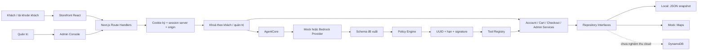
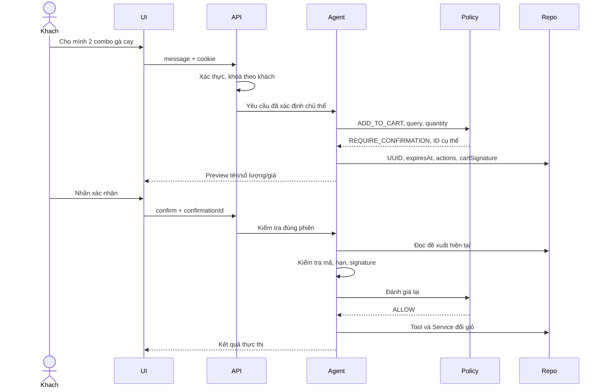
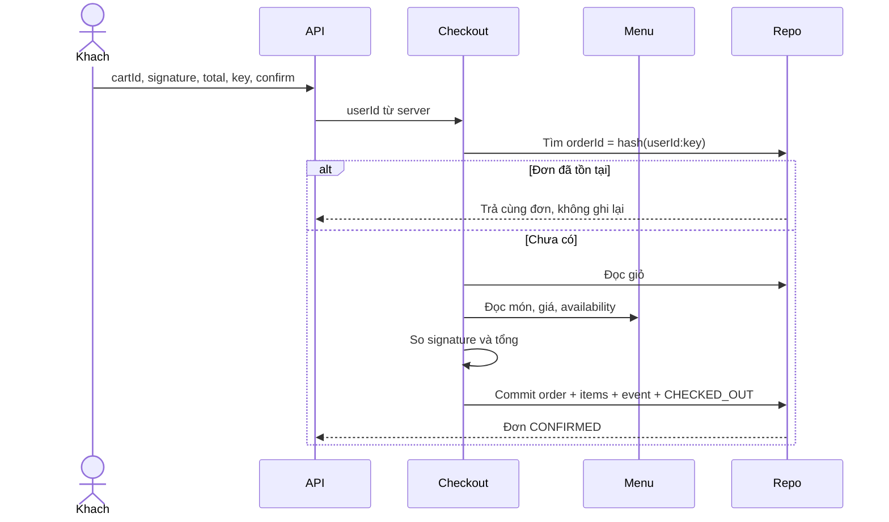
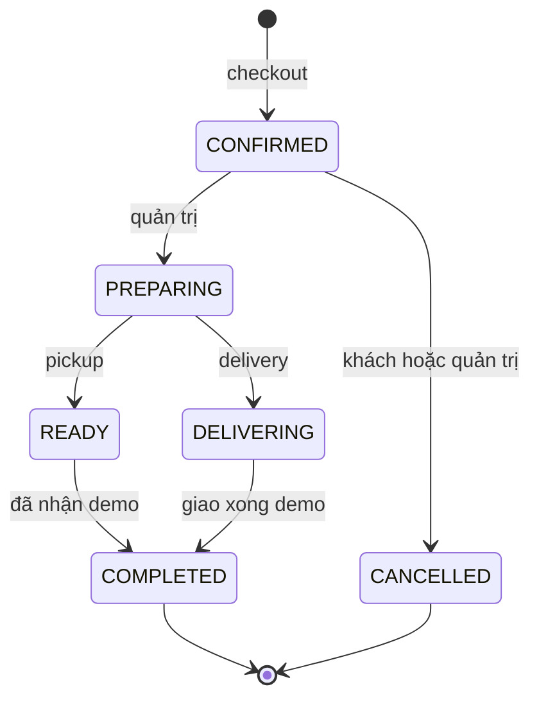
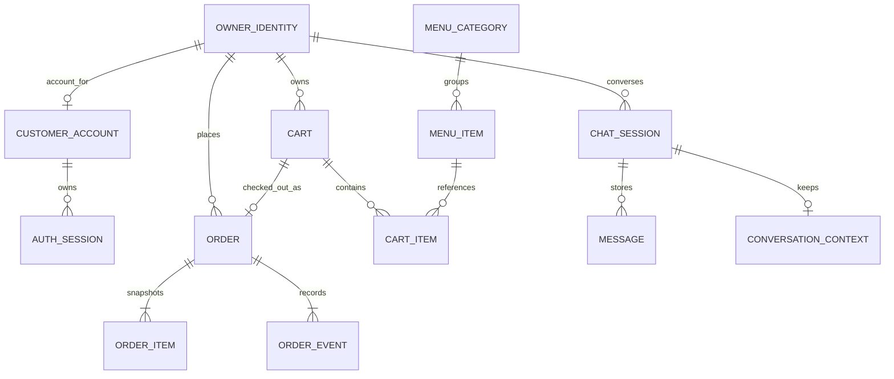
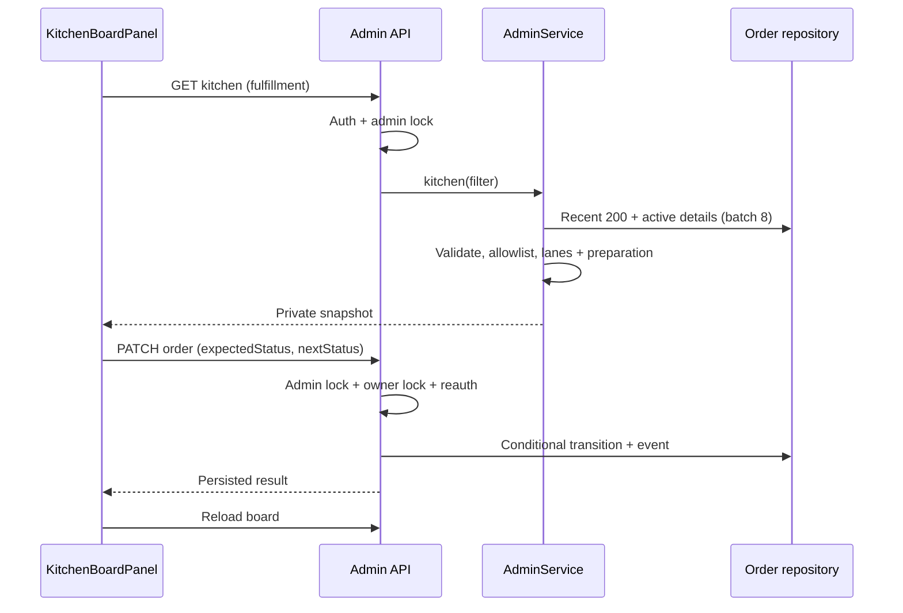
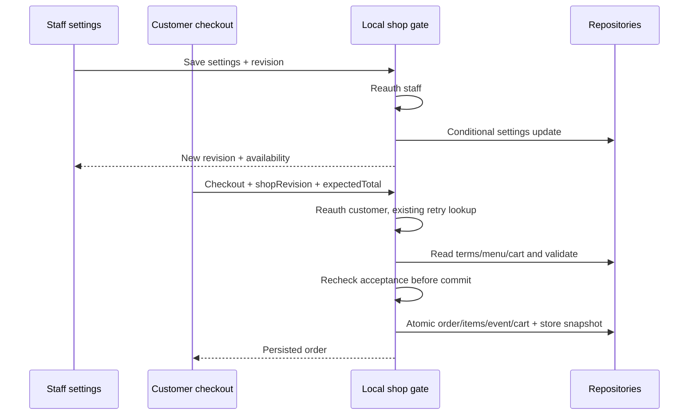
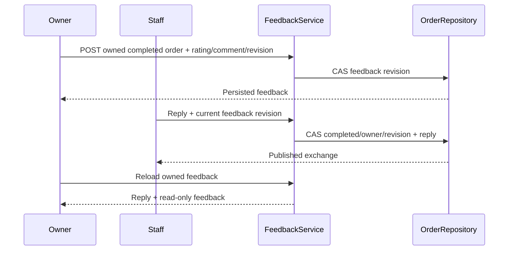
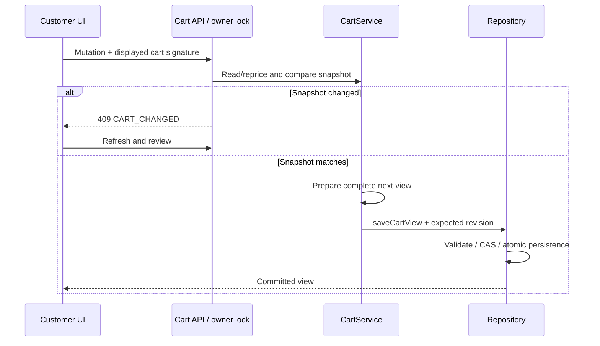
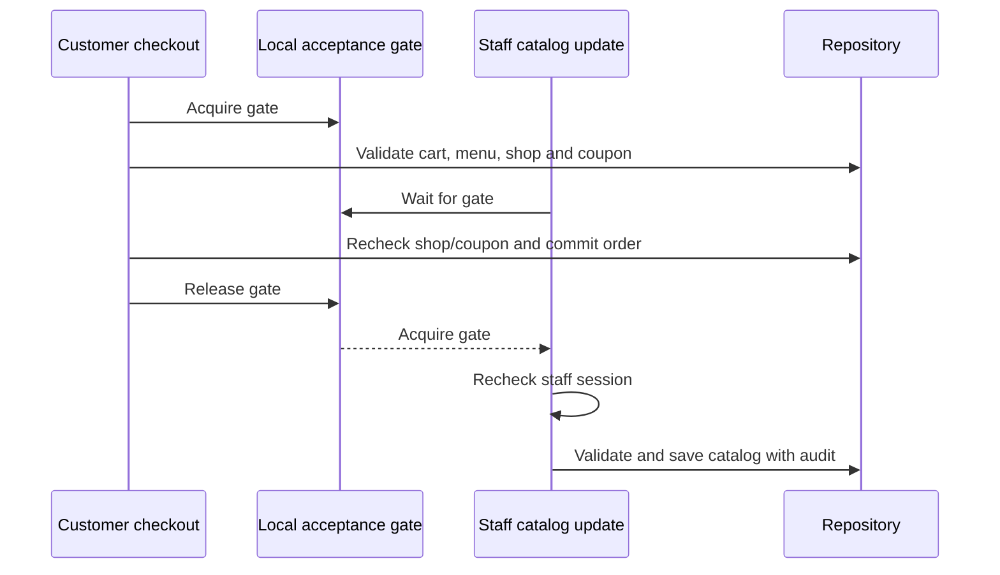

# Kiến trúc và mô hình dữ liệu

## Thành phần

Monolith chia lớp giữ đường đi giao dịch dễ kiểm chứng trong một đồ án. Provider và persistence có abstraction riêng để thay đổi hạ tầng mà không đưa AWS vào kiểm thử local.

## Trình tự chat

Provider chỉ đề xuất. Giá, tên chính thức, quyền sở hữu, chuyển trạng thái và commit do server quyết định. Gõ “Xác nhận” không cấp quyền thực thi. Tab cũ không tự lấy mã mới rồi gửi lại mà phải cho khách xem lại.

## Checkout

Local commit checkout thay đổi các map rồi ghi một snapshot qua temporary file và rename. Khi ghi lỗi, adapter khôi phục snapshot trong bộ nhớ. Đây không phải transaction database đa tiến trình. DynamoDB dùng TransactWrite ở ranh giới tương ứng nhưng chưa được nghiệm thu thật.

## Máy trạng thái đơn

ExpectedStatus được kiểm tra ở service và repository. Race huỷ/chuẩn bị chỉ có một bên thắng. Cập nhật trạng thái và event đi cùng nhau; retry bước đã đạt không thêm event trùng. PENDING/SUBMITTED chỉ là giá trị type tương thích, không được tạo bởi checkout hiện hành.

## ER logic

Đây là mô hình khái niệm, không khẳng định storage quan hệ. OWNER_IDENTITY là chủ thể logic guest/user, không phải collection lưu riêng. Guest không có bản ghi account. Order item giữ snapshot. Staff session ở map riêng trong tiến trình, không phải auth-session khách được lưu local.

## Từ điển dữ liệu

| Nhóm         | Thuộc tính chính                                | Vai trò                                  |
| ------------ | ----------------------------------------------- | ---------------------------------------- |
| Account      | id, email, fullName, passwordSalt/Hash/Kdf      | Danh tính; chỉ public profile trả client |
| Auth session | sessionId, accountId, expires                   | Thu hồi từng phiên                       |
| Menu         | id, categoryId, price, isActive/Available       | Nguồn giá và khả năng bán                |
| Cart         | id, userId, status, subtotal, total             | Giỏ theo chủ thể                         |
| Cart item    | id, menuItemId, unitPrice, quantity             | Dòng chuẩn, giới hạn số lượng            |
| Proposal     | id, expiresAt, summary, actions, signature      | Đúng thay đổi khách đã xem               |
| Order        | id, userId, cartId, status, fulfillment, total  | Snapshot đơn demo                        |
| Order item   | orderId, nameSnapshot, unitPrice, quantity      | Không phụ thuộc menu thay đổi sau đó     |
| Event        | orderId, type, actor, previousStatus, createdAt | Lịch sử vận hành                         |

Email được chuẩn hoá chữ thường. Account và email index được tạo cùng nhau. Local snapshot gồm account/session; secret ký và credentials admin ở file riêng bị Git ignore.

## Quyền và mật khẩu

Guest/customer/staff dùng cookie khác nhau. Customer/staff token có HMAC theo domain khác nhau. Customer cần session server còn hiệu lực; staff cần nonce được cấp trong tiến trình và đúng phiên bản credential. Logout thu hồi nonce tương ứng. Staff mất phiên sau restart; customer giữ phiên khi local store và secret còn nguyên.

Mật khẩu mới dùng scrypt N=32768, r=8, p=3, salt ngẫu nhiên; maxmem 64 MiB cho phép tính. Đây là một phương án được [OWASP Password Storage](https://cheatsheetseries.owasp.org/cheatsheets/Password_Storage_Cheat_Sheet.html#scrypt) công bố, không phải chứng nhận an toàn toàn hệ thống. API thực thi dùng [Node.js crypto](https://nodejs.org/api/crypto.html#cryptoscryptpassword-salt-keylen-options-callback).

Cookie không chứa mật khẩu. Hash/salt không trả qua profile, menu hoặc order. Origin, SameSite và HttpOnly là các lớp bổ sung. Rate limit hiện theo vai trò trên toàn tiến trình; cần thiết kế khác trước khi mở cho lượng người dùng lớn.

## Quyết định và đánh đổi

| Quyết định          | Lợi ích                           | Giới hạn                                      |
| ------------------- | --------------------------------- | --------------------------------------------- |
| Monolith chia lớp   | Dễ chạy và truy vết               | Chưa tách tải từng dịch vụ                    |
| JSON local          | Persistence không tài khoản cloud | Một tiến trình; chi phí ghi tăng theo dữ liệu |
| Mock mặc định       | Test tái lập, không phí inference | Parser quy tắc, không phải LLM                |
| Adapter cloud       | Có ranh giới tích hợp             | Chưa có nghiệm thu AWS                        |
| BroadcastChannel    | Đồng bộ tab cùng trình duyệt      | Không thay WebSocket đa thiết bị              |
| Compare-and-set đơn | Chặn bước cũ, có audit            | Giỏ phân tán vẫn cần versioning               |
| Báo cáo 200 đơn     | Bounded dữ liệu demo              | Không phải toàn lịch sử khi vượt 200          |

Adapter DynamoDB ghi pointer ADMIN#ORDERS cho đơn checkout mới. Dữ liệu cloud lịch sử chưa có pointer không tự backfill. Chưa thực hiện migration cloud.

## Sổ địa chỉ và cạnh tranh cập nhật

AddressService dùng UserRepository cho book riêng mỗi account. Revision SHA-256 bao gồm owner và các trường địa chỉ; repository so revision trước khi ghi toàn book. Local proxy tuần tự hoá và rollback cùng snapshot; Dynamo dùng conditional Put trên USER#id/ADDRESS_BOOK (chưa kiểm chứng cloud). Checkout tiếp tục nhận contact snapshot và xác nhận đơn như trước. Backup giữ addresses Map cùng kho dữ liệu, không thêm tệp contact riêng.

## Khuyến mãi (FR28)

PromotionService qua IMenuRepository đọc/sửa cấu hình theo code và revision UUID. Map promotions dùng cùng local snapshot; adapter Dynamo có conditional Put. Mã khuyến mãi tách khỏi catalog audit (nhật ký hiện chỉ món/danh mục). Order giữ AppliedPromotion snapshot chứ không liên kết động với chương trình hiện tại.

~~~mermaid
sequenceDiagram
  participant C as Checkout UI
  participant Q as Quote API
  participant S as PromotionService
  participant O as CheckoutService
  C->>Q: cart signature + code + fulfillment
  Q->>S: kiểm tra mã, thời gian, minimum; tính giảm
  S-->>C: code/revision/discount và tổng server
  C->>C: khách xem lại và xác nhận
  C->>O: contact + code/revision + expectedTotal + key
  O->>S: đọc lại điều kiện hiện tại
  alt mã/giỏ/giá đổi
    O-->>C: từ chối, yêu cầu xem lại
  else hợp lệ
    O->>O: commit order/items/event/cart cùng snapshot
    O-->>C: order có promotion snapshot
  end
~~~

Không có usage counter/reservation; mã có thể dùng lại. Revision chống tab quản trị cũ và phát hiện thay đổi giữa báo giá và kiểm tra checkout, không phải khóa phân tán xuyên bước tính giá/commit.

## Đặt lại và tính idempotent (FR29)

ReorderService đọc OrderRepository/MenuService, đối chiếu quyền và giỏ trống, ký preview bằng session-token helper với domain reorder. Xác nhận không nhận items/giá từ client: service resolve lại source và menu, so hai SHA256 rồi gọi CartRepository.completeReorder.

Operation UUID trong token tạo cart ID xác định theo owner. Cart lưu sourceOrderId/reorderOperationId; không thêm map/file dữ liệu. Local proxy serialise completeReorder, rollback Maps nếu ghi/rename snapshot thất bại. Tạo cart và mọi dòng trong cùng operation; cart rỗng cũ được bỏ active. Khi retry đã có cart ID tương ứng, trả cart hiện tại mà không ghi lại các dòng. Đã checkout thì không mở lại. Invalidation đề xuất chat chỉ xảy ra lần đầu, replay không xóa proposal mới.

Giới hạn local một process giữ nguyên. Dynamo TransactWrite đặt cart/items/index/base status cùng nhau nhưng các API giỏ cũ chưa có đầy đủ distributed CAS, nên chưa tuyên bố chống mọi race đa instance hoặc cloud acceptance. Token ký không mã hoá, không chứa contact và vẫn bắt buộc cookie đúng chủ.

## Báo cáo món (FR32)

AdminService.sales lấy200 order gần nhất, hash window bằng orderWindowRevision, kiểm tra basis từ dashboard rồi filterOrders dùng chung. Chỉ read items của completed bằng batch tối đa8. aggregateSales là hàm thuần, kiểm tra reconciliation, group SKU và rank; không đọc menu hiện tại, không ghi kho dữ liệu và không thêm map backup.

SalesReportPanel tách khỏi admin console. Key gồm window revision + filter + manual reload; kết quả cũ chỉ được render khi key khớp, effect cleanup abort và active guard, debounce250ms và timeout20s. Export disabled ngay khi key đổi/invalid/loading/empty. 401 gọi clearStaffView. Fingerprint không cấp quyền; cookie staff vẫn bắt buộc. Contact chỉ tham gia digest thay đổi khi cần lọc, không trả contact/raw search trong DTO/CSV.

## FR33 — view điều phối từ đơn đã lưu

Không thêm map/table hoặc sao chép đơn sang queue thứ hai; mọi lane được suy ra từ trạng thái nguồn. GET có thể cũ ngay sau khi trả, nên thao tác luôn dựa trên CAS và auth tại API. Polling chỉ là đồng bộ view trong tiến trình local, không phải message broker/distributed queue. Ghi chú thuộc dữ liệu riêng staff; API board không gửi trường contact nhưng không đảm bảo khách không tự nhập contact vào note.

## FR34 — shop settings và acceptance gate

Một record main trong menuRepository.shopSettings chứa thông tin công khai, lịch, phí/minimum và revision. Map optional khi đọc backup cũ, được local snapshot và encrypted backup giữ cùng dữ liệu khác. Record thiếu →default demo; record hiện hữu nhưng sai schema →failclosed. Dynamo adapter dùng SHOP/SETTINGS conditional revision, chưa nghiệm thu live.

Lock order: customer→shop→disk hoặc admin→shop→disk. Không giữ shop rồi xin owner/admin lock ngược chiều. Guard sau chờ gate kiểm tra auth tại boundary bắt đầu xử lý; không hứa huỷ request đã bắt đầu. Public shop reads có thể stale ngay sau response, UI revision/checkbox chỉ hỗ trợ UX; server quyết định nhận đơn. Snapshot đơn tách khỏi settings mutable; sửa settings không backfill lịch sử.

## FR35 — trao đổi riêng gắn với đơn hoàn tất

Order.feedback chứa rating/comment/revision/createdAt/updatedAt và optionalreply.message/createdAt. Chỉ stateCOMPLETED được ghi; không tạo OrderEvent trạng thái. Local order map đã có nên encrypted snapshot giữ cả feedback/reply mà không schema map mới. getRecentFeedback dùng feedback.updatedAt từ toàn orders; số đơn mới hơn không che feedback mới trên đơn cũ.

CustomerAPI ownerlock và staffAPI admin→ownerlock/reauth là boundary local; repositoryCAS vẫn bảo vệ khi service được gọi đồng thời. Dynamo dùng metadataPut conditional và ADMIN#FEEDBACK pointer replacement trong transaction; không Scan toàntable, chưa nghiệm thulive. Index list/metadata có thể đổi khi đang đọc, nên reply luôn dùng revision, không tin sourceUI. Feedback inbox DTO không gửi contact nhưng freeform text vẫn private. AI tool registry không thêm feedback tool/data source; CSV và receipt giữ các trường đã có.

## FR36 — Một commit cho metadata và các dòng giỏ

CartService chuẩn bị view mới trong bộ nhớ, không sửa mảng/đối tượng do repository đang giữ. saveCartView(cart, items, expectedRevision) kiểm tra tính hợp lệ rồi so revision/owner/ACTIVE. Lần tạo đầu dùng expectedRevision=null và kiểm tra chưa có giỏ active; legacy dùng điều kiện không có revision. Commit mới gắn UUID revision. Chữ ký nội dung vẫn gồm cartId, dòng món, số lượng, giá, tên và options; không gồm revision/updatedAt để một lần lưu không đổi nội dung không vô hiệu hoá đề xuất một cách không cần thiết.

Local Proxy bọc saveCartView bằng disk lock, chụp Maps rồi ghi store.json.tmp/rename một lần; lỗi ghi phục hồi Maps và giữ file cũ. Các method primitive còn dùng cho fixture/nội bộ tin cậy; không xem chuỗi primitive là transaction. Checkout và reorder vẫn dùng commit riêng đã có, nay checkout kiểm tra revision trước đóng giỏ. Không thay đổi lock order hoặc mô hình local một tiến trình.

Dynamo adapter dùng consistent pointer/cart/items reads, conditional metadata/pointer và diff dòng trong một TransactWrite; tối đa100 actions được kiểm tra trước ghi. Checkout/reorder cũng kiểm tra revision của giỏ nguồn. Unit chỉ dùng client transport giả để kiểm tra command/conditions/consistent flags; không có nghiệm thu AWS. Read consistency và transaction code không chứng minh an toàn của mọi workflow trên nhiều instance.

## Checkout và cập nhật catalog dùng cùng acceptance gate

Từ 08/11/2026, SHOP_ORDER_GATE bao quanh cả saveMenu, saveCategory, PromotionService.save, ShopService.save và CheckoutService.checkout. Mỗi service chuẩn bị/kiểm tra và lưu trong gate. Route staff dùng callback requireAdminSession sau khi lấy gate. Thứ tự lock giữ customer/admin trước, gate tiếp theo và disk cuối cùng. Service đang giữ gate không gọi một public mutation khác cũng xin gate.

Nếu staff lấy gate trước, checkout đọc catalog mới sau khi cập nhật hoàn tất. Retry đã có order được xử lý trước kiểm tra điều kiện mutable, giữ snapshot đơn cũ. Thời gian coupon vẫn trôi trong khi giữ lock nên evaluate được gọi lại ngay trước commit. Quote chỉ là snapshot ở thời điểm trả lời, checkout tiếp tục kiểm tra revision/tổng tiền. Phạm vi bảo đảm này áp dụng cho các service entry point trong một tiến trình local.

## Phiên bản nội dung cho form món và danh mục

AdminService.catalog trả DTO clone có catalogRevision SHA256 từ ID, timestamps và các trường catalog xác định. Các trường giá/trạng thái/tên/mô tả/danh mục/ảnh hoặc displayOrder được đưa vào phiên bản. Metadata riêng của món nằm ngoài tập trường editable này. Token được tính lại từ record, không thêm field persistence hoặc migration. Đọc catalog giữ Maps/file dữ liệu như trước.

PATCH đọc X-KFC-Catalog-Revision, kiểm tra định dạng64hex rồi truyền expectedRevision vào service. So sánh diễn ra bên trong acceptance gate sau reauth. catalogAudit đã có được dùng để xác định nội dung editable có thay đổi hay không. Sai phiên bản và có thay đổi trả409. Nếu đúng cùng nội dung hiện tại, service trả previous và giữ audit/updatedAt, cho phép phục hồi PATCH khi mất acknowledgement. Header optional cho client cũ, token không cấp quyền truy cập.

Form giữ snapshot riêng khi mở, polling dừng trong editor. Reload chỉ đọc /api/admin/menu, dùng generation guard cùng refreshVersion để bỏ kết quả cũ. Form có resetKey tăng sau reload thành công, kể cả server trả cùng phiên bản, để các uncontrolled inputs bỏ đúng bản nháp khi người dùng yêu cầu. Lỗi đọc giữ form,401 clear staff view. Hash/version và gate cung cấp bảo vệ cho bản local một tiến trình.

## Cập nhật phạm vi 09/11/2026

Giảng viên yêu cầu AI thật và triển khai AWS trước 01/01/2027. [Kế hoạch nước rút](sprint-plan-2026-11-09.md) và [AWS readiness](aws-readiness.md) bổ sung mục tiêu/bằng chứng cho phạm vi này. Bộ hiện hành đạt 101 unit + 9 recovery + 76 HTTP = 186 nhóm local, thêm 3 test AWS package offline và 3 test verifier ZIP riêng. Các mốc/số đếm trước đó là lịch sử. Preflight AWS chỉ đọc đã qua; inference, image Linux và nghiệm thu trên AWS còn chờ thực hiện, chưa đánh dấu hoàn tất.
